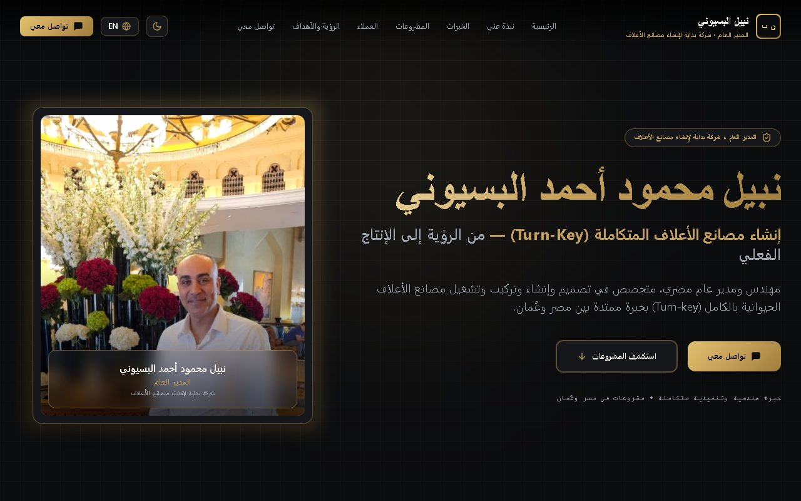

# Eng. Nabil El-Basyouni — Bilingual Executive Portfolio



🌐 **Live Website:** [nabil-elbasyouni-portfolio.vercel.app](https://nabil-elbasyouni-portfolio.vercel.app/)  
👨‍💻 **Frontend Engineering & UI/UX Design:** [Mostafa Mohamed Farhat (Elshorbagy)](https://mostafa-portfolio-iota.vercel.app/)

---

## Overview

A bilingual (Arabic / English) executive personal brand website built for **Eng. Nabil El-Basyouni**, showcasing executive leadership and turn-key industrial feed mill engineering projects across Egypt and Oman.

### Key Features
- **Bilingual AR/EN Interface:** Seamless switching between Arabic RTL and English LTR layouts.
- **Executive Track Record & Project Showcase:** Highlights major industrial engineering milestones, regional operations, and executive consultation channels.

---

## Tech Stack
- **Framework:** React + Vite
- **Styling:** Modern CSS / Responsive Editorial Layout
- **Deployment:** Vercel

---

## Local Development

```bash
npm install
npm run dev
npm run build
```
